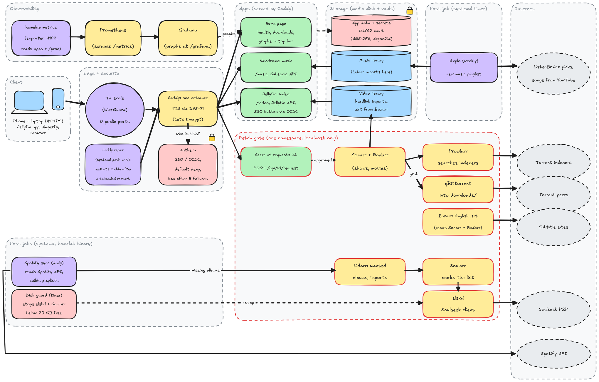

<div align="center">

# homelab

Your own Netflix and Spotify, at home.

<a href="https://jellyfin.org"></a>
<a href="https://github.com/seerr-team/seerr"></a>
<a href="https://www.bazarr.media"></a>
<a href="https://www.navidrome.org"></a>
<a href="https://sonarr.tv"></a>
<a href="https://radarr.video"></a>
<a href="https://prowlarr.com"></a>
<a href="https://www.qbittorrent.org"></a>
<a href="https://lidarr.audio"></a>
<a href="https://github.com/slskd/slskd"></a>
<a href="https://gethomepage.dev"></a>

<a href="https://tailscale.com"><picture><source media="(prefers-color-scheme: dark)" srcset="https://cdn.jsdelivr.net/gh/homarr-labs/dashboard-icons@83f32e08257b66fbd971ac8d7645f5b38d52e85d/svg/tailscale-light.svg"></picture></a>
<a href="https://caddyserver.com"></a>
<a href="https://www.authelia.com"></a>
<a href="https://www.docker.com"></a>
<a href="https://www.rust-lang.org"><picture><source media="(prefers-color-scheme: dark)" srcset="https://cdn.jsdelivr.net/gh/homarr-labs/dashboard-icons@83f32e08257b66fbd971ac8d7645f5b38d52e85d/svg/rust-dark.svg"></picture></a>

</div>

- Watch and listen anywhere
- One login for every app
- Request a show or movie; it downloads with subtitles
- Spotify playlists sync; paste any public link at `/playlists`
- Home page with downloads and graphs
- Encrypted logins, keys and databases



## Install

Needs Linux, Docker and Tailscale with HTTPS certificates on. Run as your main user:

```sh
./scripts/setup.sh
```

It sets up every app and three public indexers, then asks about Spotify sync, encryption and a weekly playlist. Torrents use your home IP address, with no VPN.

## Later

- **After a reboot, if encrypted:** `sudo ./scripts/vault-unlock.sh`
- **New password:** `./scripts/set-password.sh`
- **Albums first:** one `Artist - Album` per line in `DATA/priority-albums.txt` (`DATA` is in `.env`)
- **Ports 9090 or 3000 taken:** point your Prometheus at `127.0.0.1:9102` and serve Grafana at `/grafana` with anonymous viewers and data source uid `prometheus`
- **After a code change:** `./scripts/install-homelab.sh`, then `systemctl --user restart homelab-lab-metrics`
